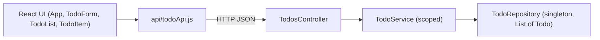

# Technical Requirements Document: Todo Application, Version 1

> **Note on PRD conflict:** The PRD (FR-2) states limits of 100 characters for the title and 500 for the description. This TRD uses the architect-mandated limits of **200** and **1000**. The PRD should be updated to match.

## 1. Architecture Overview

Single-user, two-tier web application. There is no authentication and no database.

- **Frontend:** React (JavaScript, Vite, functional components, `useState`). Only `api/todoApi.js` calls `fetch`.
- **Backend:** C# 14 / .NET 10 ASP.NET Core Web API (controllers) at `http://localhost:8000`, with no `/api` prefix.
- **Layering:** `TodosController` → `ITodoService` → `ITodoRepository`. Each layer talks only to the layer directly below it.
- **Storage (V1):** A `List<Todo>` inside `TodoRepository`. Data is lost on restart (FR-1, PRD Data lifetime).
- **Lifetimes:** `TodoRepository` is a singleton and `TodoService` is scoped.
- **CORS:** Allows any origin whose host is `localhost`, on any port.
- **Frontend configuration:** The API base URL comes from `VITE_API_URL`, falling back to `http://localhost:8000`.
- **Format:** JSON bodies with PascalCase property names, exactly as the field names.



## 2. Folder Structure

```text
TodoApp.slnx
backend/
└── TodoApp.Api/
    ├── Controllers/
    │   └── TodosController.cs
    ├── Services/
    │   ├── ITodoService.cs
    │   └── TodoService.cs
    ├── Repositories/
    │   ├── ITodoRepository.cs
    │   └── TodoRepository.cs
    ├── Models/
    │   └── Todo.cs
    ├── Dtos/
    │   ├── CreateTodoRequest.cs
    │   ├── UpdateTodoRequest.cs
    │   └── TodoResponse.cs
    └── Program.cs
frontend/
├── .env                      (optional: VITE_API_URL)
└── src/
    ├── App.jsx
    ├── api/
    │   └── todoApi.js
    └── components/
        ├── TodoForm.jsx
        ├── TodoList.jsx
        └── TodoItem.jsx
docs/
└── PRD.md
```

## 3. Data Model

### Todo (`Models/Todo.cs`)

| Field | Type | Required | Description | PRD |
|---|---|---|---|---|
| Id | int | Yes (system) | Generated by the repository, starting at 1. Never changes and is never reused during a server session. | FR-1, FR-5 |
| Title | string | Yes | Trimmed, 1 to 200 characters. Whitespace-only is invalid. | FR-1, FR-2, FR-6 |
| Description | string? | No | Up to 1000 characters. | FR-1, FR-2, FR-6 |
| DateCreated | DateTime | Yes (system) | Set by the service with `DateTime.UtcNow`. Never changes. | FR-1, FR-3 |
| IsCompleted | bool | Yes (system) | `false` on creation. | FR-1, FR-7, FR-8 |

### DTOs

| DTO | Fields | Validation |
|---|---|---|
| `CreateTodoRequest` | `Title` (string, required), `Description` (string?, optional) | Required Title, not whitespace-only, 200 characters or fewer after trimming. Description 1000 characters or fewer. |
| `UpdateTodoRequest` | `Title` (string, required), `Description` (string?, optional), `IsCompleted` (bool, required) | Same rules as `CreateTodoRequest`. |
| `TodoResponse` | `Id`, `Title`, `Description`, `DateCreated`, `IsCompleted` | None (output only). |

- DTO validation attributes produce the 400 response (FR-2).
- `TodoService` also throws `ArgumentException` for the same violations (FR-2).
- `TodosController` maps `ArgumentException` to 400.
- JSON uses PascalCase. `DateCreated` is serialized as an ISO 8601 UTC string, and the UI shows it in local time.

## 4. API Endpoints

No `/api` prefix. Error bodies are ProblemDetails JSON with a human-readable message (FR-11, FR-12).

| Method | Path | Request body | Response body | Status codes | PRD |
|---|---|---|---|---|---|
| GET | `/todos` | None | `TodoResponse[]`, newest first (by `DateCreated` descending, then `Id` descending) | 200 | FR-3, FR-4, FR-10 |
| GET | `/todos/{id}` | None | `TodoResponse` | 200, 404 | FR-5, FR-11 |
| POST | `/todos` | `{ "Title", "Description" }` | Created `TodoResponse`, with a `Location` header pointing to `/todos/{id}` | 201, 400 | FR-1, FR-2 |
| PUT | `/todos/{id}` | `{ "Title", "Description", "IsCompleted" }` | Updated `TodoResponse` | 200, 400, 404 | FR-6, FR-7, FR-8, FR-11 |
| DELETE | `/todos/{id}` | None | None | 204, 404 | FR-9, FR-11 |

- Complete and reopen use `PUT` with the full body and a changed `IsCompleted`.
- `PUT` cannot change `Id` or `DateCreated`.
- The empty state (FR-10) is `GET /todos` returning `200 []`.

## 5. Backend Layers

### Controller: `TodosController`

- **Responsibility:**
  - Routes (`[Route("todos")]`) and model binding.
  - Automatic DTO validation (`[ApiController]`).
  - Maps service results to status codes: `null` becomes 404, `false` becomes 404, and `ArgumentException` becomes 400.
  - Builds the 201 `Location` header with `CreatedAtAction`.
- **May not:**
  - Contain business rules.
  - Access `ITodoRepository` or `Todo` directly.
  - Generate Ids or dates.

### Service: `ITodoService` / `TodoService` (scoped)

- **Responsibility:**
  - Trims the Title.
  - Enforces length and required rules, throwing `ArgumentException`.
  - Sets `DateCreated = DateTime.UtcNow` and `IsCompleted = false` on create.
  - Preserves `Id` and `DateCreated` on update.
  - Orders `GetAll` newest first.
  - Maps `Todo` to `TodoResponse`.
- **May not:**
  - Touch the list or any storage directly.
  - Know about HTTP, status codes, or `ActionResult`.
  - Generate Ids.

### Repository: `ITodoRepository` / `TodoRepository` (singleton)

- **Responsibility:**
  - It is the only code that touches storage (the `List<Todo>`).
  - `Add` assigns the next Id, starting at 1 and never reused.
  - `GetAll` returns a snapshot as `IReadOnlyList<Todo>`.
  - `Update` and `Delete` return `false` when the Id is not found.
  - All list access is protected by a lock, because the singleton is shared across concurrent requests.
- **May not:**
  - Validate business rules.
  - Set `DateCreated`.
  - Reference DTOs or HTTP types.

### Interfaces (exact signatures)

```csharp
// Repositories/ITodoRepository.cs
public interface ITodoRepository
{
    IReadOnlyList<Todo> GetAll();
    Todo? GetById(int id);
    Todo Add(Todo todo);
    bool Update(Todo todo);
    bool Delete(int id);
}

// Services/ITodoService.cs
public interface ITodoService
{
    IReadOnlyList<TodoResponse> GetAll();
    TodoResponse? GetById(int id);
    TodoResponse Create(CreateTodoRequest request);
    TodoResponse? Update(int id, UpdateTodoRequest request);
    bool Delete(int id);
}
```

### Registration and hosting (`Program.cs`)

```csharp
builder.Services.AddSingleton<ITodoRepository, TodoRepository>();
builder.Services.AddScoped<ITodoService, TodoService>();
```

- Kestrel listens on `http://localhost:8000`.
- The CORS policy accepts an origin only if its host is `localhost`.

## 6. Frontend Components

| Component / module | Responsibility | State owned | PRD |
|---|---|---|---|
| `App.jsx` | Root component. Loads todos on mount, coordinates create, edit, complete, reopen, and delete through `todoApi`. Shows the notice that data is not saved permanently. Shows success and error feedback. | `todos` (array), `editingTodo` (object or null), `message` (success or error text), `isLoading` (bool) | FR-1 to FR-12 |
| `components/TodoForm.jsx` | Form for create and edit. Provides client-side validation hints (required, 200/1000 limits) and displays server validation errors. Does not call the API. | `title`, `description`, `errors` | FR-1, FR-2, FR-6 |
| `components/TodoList.jsx` | Renders the list of `TodoItem` components, or the empty-state message. Order is as received from the server (newest first). | None (stateless, props only) | FR-3, FR-4, FR-10 |
| `components/TodoItem.jsx` | Shows title, status, and creation date in local time. Completed items are visually distinct, with a text or icon marker rather than color alone. Provides complete or reopen, edit, and delete controls. Shows the delete confirmation before calling the delete callback. | `isConfirmingDelete` (bool) | FR-3, FR-5, FR-7, FR-8, FR-9 |
| `api/todoApi.js` | The only module that calls `fetch`. Exposes `getAll`, `getById`, `create`, `update`, and `remove`. Reads the base URL from `import.meta.env.VITE_API_URL`, falling back to `http://localhost:8000`. Converts non-2xx responses into errors with readable messages, including 404 "not found". | None | FR-1 to FR-12 |

Additional frontend rules:

- User text is rendered as plain text, never as HTML.
- All actions are keyboard operable.
- A single todo can be opened from the list (FR-5) via `getById`.
- A 404 shows a "not found" message and refreshes the list (FR-11).

## 7. Version 2 Migration Note

When SQLite is introduced through Entity Framework Core with migrations, these files change:

| File | Change |
|---|---|
| `Repositories/TodoRepository.cs` | The `List<Todo>` is replaced by EF Core data access. The `ITodoRepository` signatures are kept. |
| `Program.cs` | The repository registration line is replaced, for example with a scoped registration, as required by the data context. |

Not changed: `TodosController.cs`, `ITodoService.cs`, `TodoService.cs`, `ITodoRepository.cs`, `Todo.cs`, all DTOs, and every frontend file.

Additions outside the existing files: the database context, migrations, and package references. These are infrastructure for the repository only. The contract (API, DTOs, service) is unchanged.

Version 2 is completed

## 8. Traceability Table

| PRD requirement | TRD section(s) |
|---|---|
| FR-1 Create todo | 3 (Todo, `CreateTodoRequest`), 4 (POST), 5 (Service, Repository), 6 (`TodoForm`, `App`) |
| FR-2 Title validation | 3 (DTO validation, limits 200/1000), 4 (400 responses), 5 (Service `ArgumentException`), 6 (`TodoForm`) |
| FR-3 List todos | 4 (GET `/todos`), 6 (`TodoList`, `TodoItem`) |
| FR-4 Order of list | 4 (GET `/todos` ordering), 5 (Service ordering), 6 (`TodoList`) |
| FR-5 View todo | 4 (GET `/todos/{id}`), 6 (`TodoItem`, `todoApi`) |
| FR-6 Edit todo | 3 (`UpdateTodoRequest`), 4 (PUT), 5 (Service preserves `Id` and `DateCreated`), 6 (`TodoForm`) |
| FR-7 Complete todo | 4 (PUT with `IsCompleted`), 6 (`TodoItem`) |
| FR-8 Reopen todo | 4 (PUT with `IsCompleted`), 6 (`TodoItem`) |
| FR-9 Delete todo | 4 (DELETE), 5 (Repository), 6 (`TodoItem` confirmation) |
| FR-10 Empty state | 4 (`200 []`), 6 (`TodoList`) |
| FR-11 Not found | 4 (404 on GET, PUT, DELETE), 5 (Controller mapping), 6 (`todoApi`, `App`) |
| FR-12 Feedback | 4 (ProblemDetails messages), 6 (`App` message state) |
| Non-functional: Data lifetime, Consistency | 1, 3 (Id), 5 (Repository) |
| Non-functional: Reliability | 3, 5 (Repository lock, validation) |
| Non-functional: Security, Accessibility, Usability | 6 (frontend rules) |
| Non-functional: Compatibility | 1 (CORS, Vite frontend) |
| Roadmap: Version 2 | 7 |